# SGLang Scheduler and Transfer Optimization

Per-request mapping copies and repeated CPU–GPU transfers add overhead before SGLang launches model execution. Fused prefix mapping, native integer packing and event-guarded transfers consolidate these scheduler paths. On H100, complete preparation latency fell by **51.1%–54.0%** for cache-hit batches and **21.9%–43.1%** for longer prefills.

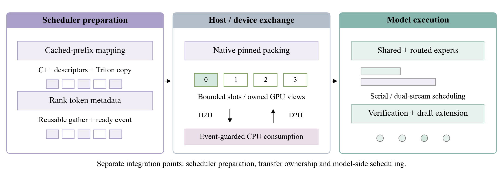

Experiments run on two NVIDIA H100 SXM GPUs with 80 GB HBM3 each and NVLink (NV6), using PyTorch 2.7.1+cu126, Triton 3.3.1 and SGLang 0.4.9.post6. Scheduler collectives use two GPU ranks. Model-serving tests use one GPU with tensor parallelism set to one. Scheduler and expert-policy comparisons use three fresh process launches, and EAGLE variants use two paired launches with one target-only reference.

| Workstream | Measured operation | Result against its control | Details |
|---|---|---|---|
| 1. Pinned transfers | Complete longer-prefill preparation | **21.9%–43.1% less latency** | [Controls](docs/EXPERIMENTS.md#pinned-transfers) |
| 2. Expert scheduling | Complete-model HTTP output throughput | Serial **3.9%–5.1% higher** than upstream dual stream | [Mode comparison](docs/EXPERIMENTS.md#expert-scheduling) |
| 3. Verification transfer | Complete-request verified output throughput | Packed transfer **−0.9% to +9.4%** throughput across nine cells | [Serving comparison](docs/EXPERIMENTS.md#verification-transfer) |
| 4. Cached-prefix scheduling | Cache-hit scheduler preparation | **51.1%–54.0% less latency**, **2.25×** largest two-rank case | [Controls](docs/EXPERIMENTS.md#cached-prefix-scheduling) |
| 5. Async metadata gather | All-gather + CPU metadata/descriptor preparation | **30.1%–40.4% less latency** | [Controls](docs/EXPERIMENTS.md#async-metadata-gather) |

Each row reports the measured operation against its corresponding control.

## 1. Pinned transfers

**Complete longer-prefill preparation fell by 21.9%–43.1%.** CPU integer construction adds allocation and staging before model execution.

My C++ producer packs four integer groups directly into reusable pinned memory. One upload returns owned GPU views. Events and leases protect reuse and CPU reads.

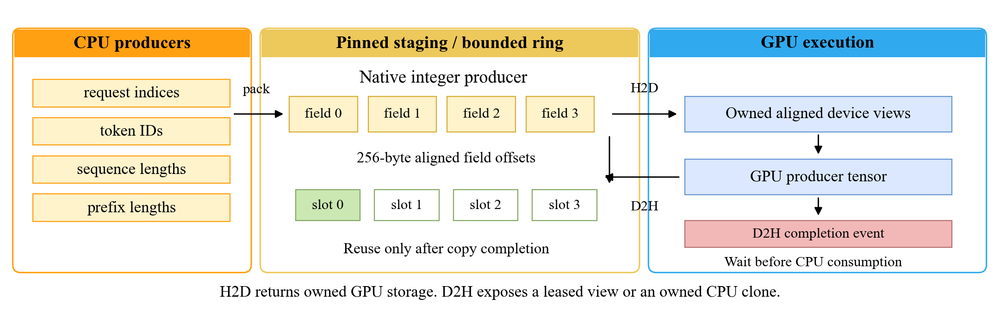

One aligned upload produces four owned GPU views, reducing preparation from **6.143 ms to 3.497 ms** at 8/11 requests across the ranks and 8192 new tokens per request.

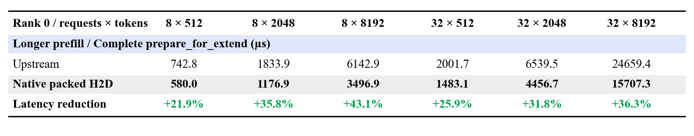

[Producer packing, transfer ownership and DMA controls](docs/EXPERIMENTS.md#pinned-transfers).

## 2. Expert scheduling

**Serial scheduling improved ordinary-call serving throughput by 3.9%–5.1%.** The scheduling policy depends on execution mode. I added allocation-lifetime guards and measured both schedules with shared-expert fusion disabled. Serial leads in ordinary execution. Dual stream leads in the one-token CUDA Graph comparison.

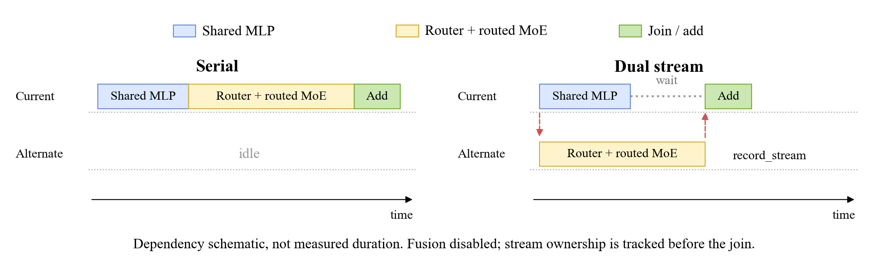

Dashed arrows mark the cross-stream dependencies that coordinate dual-stream execution, which reduces one-token graph-replay latency from **109.2 µs to 96.2 µs**.

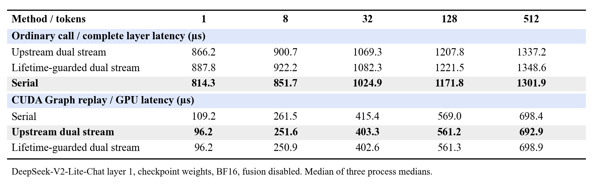

[Complete-model results, routing controls and stream lifetime](docs/EXPERIMENTS.md#expert-scheduling).

## 3. Verification transfer

**Packed verification transfer changed useful throughput by −0.9% to +9.4% across nine serving configurations.** EAGLE acceptance consumes GPU results on the CPU. I consolidated those results into one owned pinned D2H snapshot. The four-query tentative extension recorded a **−4.8% to +7.9%** throughput change and matched all **288** paired serial outputs.

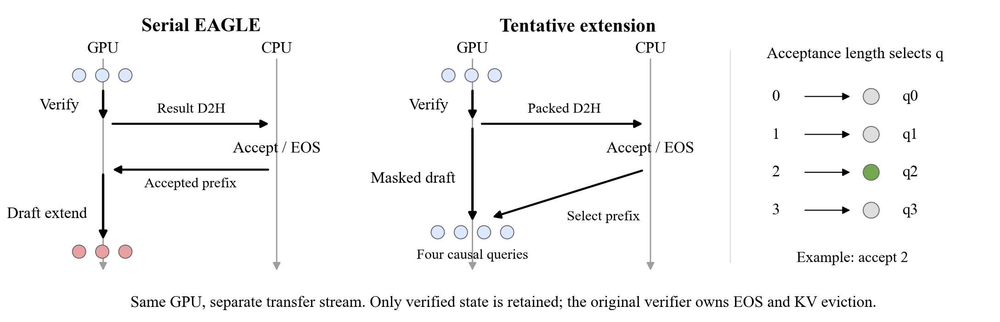

The packed D2H snapshot supplies CPU acceptance metadata, raising throughput from **686.7 to 751.4 token/s** at 128 input tokens / concurrency 16.

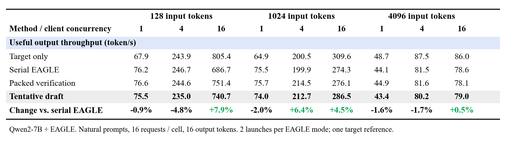

[Acceptance semantics, precision checks and serving measurements](docs/EXPERIMENTS.md#verification-transfer).

## 4. Cached-prefix scheduling

**Cache-hit scheduler preparation fell by 51.1%–54.0%, reaching 2.25× speedup in the largest two-rank case.** Multi-turn and agent cache-hit batches perform request-to-token mapping before GPU forward execution. Per-request copy launches add batch preparation overhead.

I fused the cached-prefix loop in `ScheduleBatch.prepare_for_extend` using C++ descriptors and Triton, preserving upstream extend-token mapping.

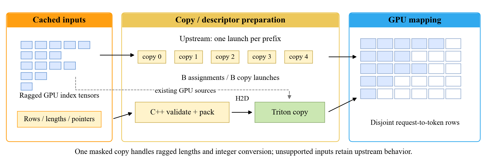

Descriptors are packed once in C++ and consumed by one masked Triton copy, reducing complete two-rank preparation from **7.622 ms to 3.389 ms** at 512 requests per rank.

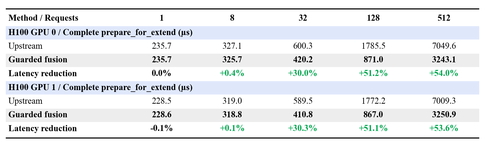

[Dispatch guards, two-rank results and descriptor ablations](docs/EXPERIMENTS.md#cached-prefix-scheduling).

## 5. Async metadata gather

**Complete metadata and descriptor preparation fell by 30.1%–40.4%.** CPU consumption of small per-rank counts adds allocation and synchronization costs before dispatch.

I combined buffer reuse, asynchronous NCCL gathering and event-guarded D2H. Buffer reuse and consolidated CPU consumption drive the gain. The selected immediate-wait policy runs **1.0%–2.0% faster** than deferred consumption. Separate traces reduced seven stream synchronizations to one event wait.

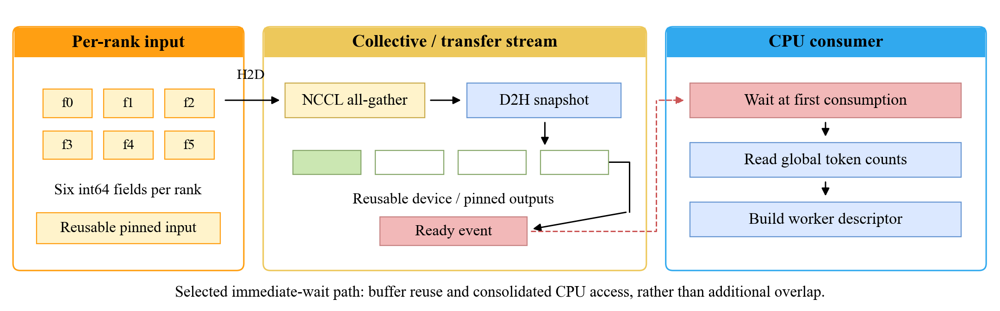

The completion event gates CPU access to gathered counts, and complete metadata and descriptor preparation falls from **428.6 µs to 272.6 µs** at 128/131 requests across the two ranks.

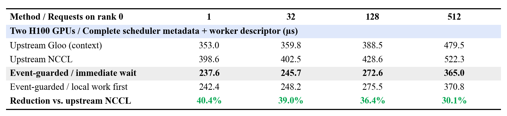

[Immediate-wait controls, Gloo comparison and ownership](docs/EXPERIMENTS.md#async-metadata-gather).

## Implementation

- [Prefix mapping](runtime_opt/prefix_copy.py) and [native descriptors](runtime_opt/csrc/prefix_descriptors.cpp)
- [Rank metadata](runtime_opt/async_metadata.py), [pinned transfer ownership](runtime_opt/pinned_transfers.py) and [native integer staging](runtime_opt/csrc/integer_staging.cpp)
- [Expert policies](runtime_opt/expert_scheduling.py), [verification snapshots](runtime_opt/verification_transfer.py) and [tentative draft execution](runtime_opt/tentative_draft.py)
- [SGLang patches](integrations/sglang), [benchmarks](benchmarks) and [aggregated measurements](results/measurements.json)

## Validation

| Workstream | Coverage | Compute Sanitizer memcheck | Entry point |
|---|---|---|---|
| Prefix mapping | 72 kernel subcases, 50 actual scheduler cases | Zero errors (kernel/scheduler) | [Checks](integrations/sglang/validate_prefix_copy.py) |
| Async metadata gather | 42 two-rank groups, 7 scheduler guards | Zero errors, both ranks | [Checks](integrations/sglang/validate_async_metadata.py) |
| Pinned transfers | 51 two-rank groups, 42 metadata regression groups | Zero errors, both ranks | [Checks](integrations/sglang/validate_pinned_transfers.py) |
| Expert scheduling | Routing, stream and replay controls, 864 exact serving comparisons | Zero errors (prepared controls) | [Checks](benchmarks/expert_controls.py) |
| Verification transfer | 2850 CPU state combinations, 18 attention cases, 288 exact serving pairs | Zero errors (attention/transfer) | [Checks](benchmarks/validate_tentative_attention.py) |

[Validation details](docs/EXPERIMENTS.md#validation) document coverage, execution conditions and the scope of each test family.

## Run

Linux, CUDA and a C++ compiler are required. The tested stack is PyTorch 2.7.1+cu126, Triton 3.3.1 and SGLang 0.4.9.post6. Scheduler tests use two NVLink-connected H100s. Serving uses one H100 with TP one.

```bash
python3.11 -m venv .venv
source .venv/bin/activate
python -m unittest discover -s tests -p 'test_*.py'
PYTHONPATH=. python -m benchmarks.prefix_copy \
  --batches 128 512 --lengths 512 --cpp-comparison \
  --output results/new-prefix.json
```

The commands run the full unit suite, including CUDA prefix-copy checks, and benchmark the copy mechanism. [Integration and model checks](docs/EXPERIMENTS.md#running-validation) cover scheduler and serving execution. [Scheduler integration](docs/EXPERIMENTS.md#source-integration), [server launcher](tools/launch_runtime_server.py) and [request client](benchmarks/model_serving.py) cover the framework and serving paths.

## License

Original contributions are Copyright (c) 2026 Lucia Huang and licensed under the [Apache License, Version 2.0](LICENSE). See [NOTICE](NOTICE). Third-party code retains its original copyright and license notices; the SGLang upstream license is preserved in [integrations/sglang/UPSTREAM_LICENSE](integrations/sglang/UPSTREAM_LICENSE).
