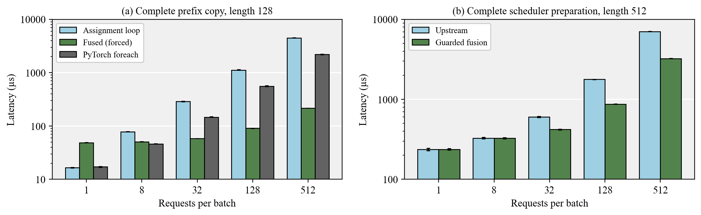
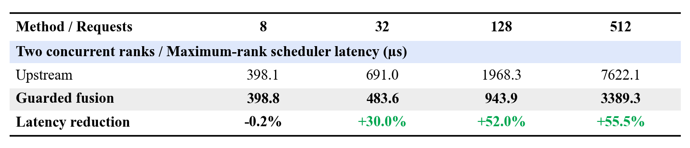
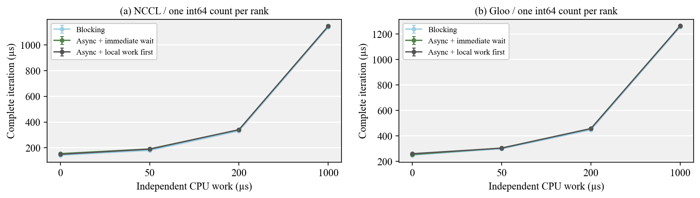
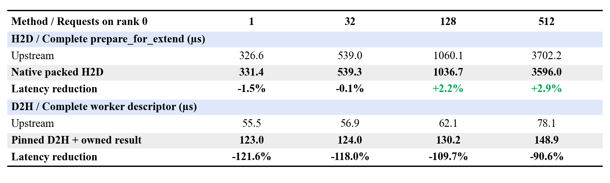
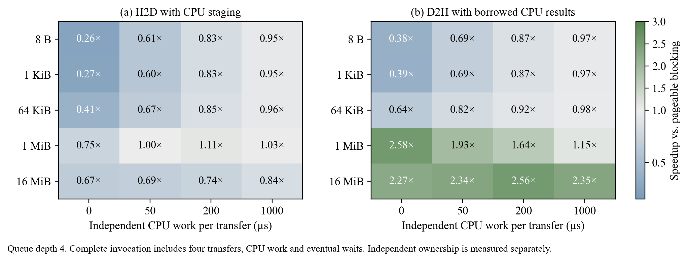
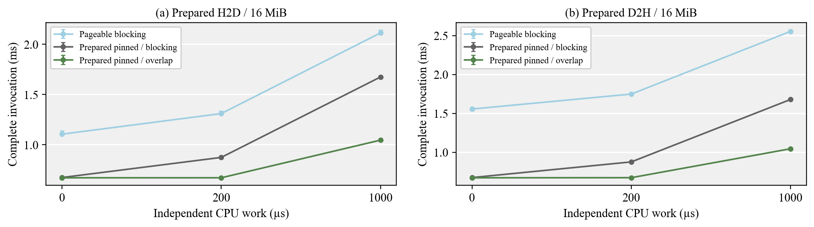
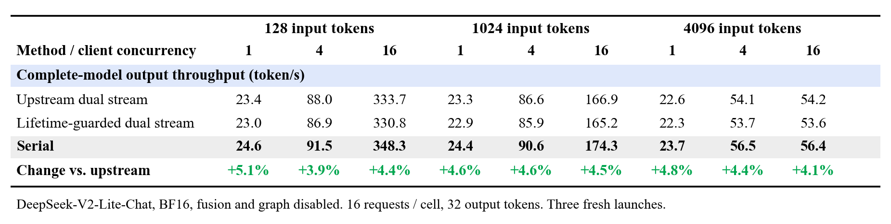

# Experiments and implementation details

Detailed controls, additional figures and validation scope for the five runtime paths.

## Cached-prefix scheduling

The implementation targets `ScheduleBatch.prepare_for_extend` in SGLang 0.4.9.post6. C++ validates and packs source pointers, request rows, lengths and dtype tags into pinned storage. One descriptor upload feeds a masked Triton copy into the int32 request-to-token table. The existing upstream kernel for newly allocated extend tokens stays in place.

Three fresh-process runs on each GPU measured the complete scheduler preparation, including request-slot allocation, token-index allocation, prefix mapping and sampling metadata. With 128 or 512 requests and 512 cached tokens per request, latency fell by **51.1%–54.0%** across the two devices.

The copy loop's cost grew mainly with request count across prefix lengths 1–512. A first fused implementation exposed Python descriptor construction as the next bottleneck. In a controlled 128-request ablation, moving validation and packing to C++ reduced inclusive fused-copy latency from **396.3 µs to 91.5 µs**. A separate profiler run reduced prefix-copy launches from **128 to 1**; the complete scheduler trace went from **130 to 3** kernel launches.



The chart shows GPU 0. Bars are medians of three process medians; whiskers show their range. The isolated copy panel forces fusion to expose its crossover. The scheduler panel uses the selected dispatch policy, which starts at 16 nonempty prefixes.

### Concurrent scheduler ranks

Concurrent two-rank measurements take the slower rank for every matched invocation. At 128 requests, complete preparation fell from **1.968 ms to 0.944 ms**. At 512 requests, it fell from **7.622 ms to 3.389 ms**, a **2.25× speedup**.



The dispatch policy was fixed before evaluating irregular prefixes and additional request counts. Active held-out shapes improved by **1.61×–2.16×**. Zero-hit controls measured **0.4%–1.6% higher latency** with dispatch enabled. Small batches, SWA requests, unsupported layouts and overlapping storage retain the original copy path.

## Async metadata gather

The distributed attention scheduler gathers six int64 fields per rank and immediately reads them on the CPU. The patch uses reusable pinned buffers, an asynchronous NCCL gather and one event-guarded D2H transfer. An experimental path prepares the real local worker descriptor before consuming global metadata.

Across three fresh launches, complete metadata preparation plus worker descriptor construction fell by **30.1%–40.4%** against the original NCCL path. Each invocation includes the eventual wait and reports the slower of two ranks. Rank 1 has three more requests than rank 0.

The immediate-wait control was **1.0%–2.0% faster** than moving local descriptor work ahead of consumption, so it is the selected path. Separate traces reduced **seven CUDA stream synchronizations to one event wait per invocation**. The measured gain comes from buffer reuse and consolidated host consumption; additional communication overlap did not improve these workloads.

One-count controls with 0–1000 µs of independent CPU work also show no systematic overlap advantage. The upstream Gloo row uses the existing overlap-scheduler configuration and is retained as context. These measurements cover scheduler preparation, not model forward or serving throughput.



## Pinned transfers

The input path packs four CPU integer groups directly into reusable pinned storage through C++. One upload returns four owned GPU views with 256-byte field alignment. The transfer ring separately enforces producer ordering, completion events and CPU-result leases.

Across six longer-prefill shapes, complete `prepare_for_extend` latency fell by **21.9%–43.1%**. At 8/11 requests across the two ranks and 8192 new tokens per request, it fell from **6.143 ms to 3.497 ms**. The gain includes native integer packing, staging reuse and upload consolidation.

Table request counts refer to rank 0; rank 1 has three more requests. Measurements use the slower rank for each invocation and the median of three fresh-process medians. Logprob output is disabled in the longer-prefill experiment.

Small inputs show the boundary. H2D was effectively tied at 32 requests and improved by **2.2%–2.9%** at 128/512. Deferred sequence-length D2H with an owned result was **1.91×–2.22× slower**, so its source flag remains disabled by default.



The generic ring covers 8 B–16 MiB, queue depths 1/2/4 and 0–1000 µs of independent CPU work. Four 16 MiB D2H transfers with 1000 µs of work per transfer fell from **9.991 ms to 4.249 ms** with borrowed results. Preserving independent CPU copies increased latency to **9.599 ms**. Adding staging after pageable input tensors already exist often erased H2D gains.



Prepared pinned producers isolate the DMA benefit. For 16 MiB and 1000 µs of independent CPU work, H2D and D2H improved by **2.02× and 2.44×**, with pinning allocation and extra host staging excluded. The source implementation obtains its larger-prefill benefit by producing packed integers directly in pinned memory.



## Expert scheduling

The checkpoint-weight DeepSeek-V2-Lite layer exposes an execution-mode boundary. Serial execution reduced ordinary-call latency by **2.6%–6.0%** against the upstream dual-stream path with the trained router. Under CUDA Graph replay, upstream dual stream reduced the one-token layer latency from **109.2 µs to 96.2 µs**.

The local stream path adds allocation-lifetime tracking. Shared-expert fusion is disabled in every pair, and fresh input copies account for the routed kernel's in-place behavior. Prepared cyclic-balanced and skewed routes test the same scheduling choices on held-out token counts.

Graph timings cover the isolated MoE layer. In complete-model ordinary execution, serial scheduling increased HTTP output throughput by **3.9%–5.1%** across input lengths 128, 1024 and 4096 and client concurrency 1, 4 and 16.



## Verification transfer

The EAGLE path launches one packed verification-result D2H transfer and prepares a four-query draft extension before CPU reconciliation. A Triton mask excludes future cached keys for every potentially selected query. The original verifier still decides which tokens are accepted, handles request completion and frees rejected target KV locations.

The draft checkpoint's architecture label required a separate SGLang configuration adapter so its fusion projection was loaded. Weight tensors stay unchanged. The implementation uses full target greedy IDs for speculative inputs rather than the verifier's partially initialized output buffer.

Complete requests compare target-only decoding, serial EAGLE, packed verification transfer and tentative draft execution. They use deterministic natural-language prompts and count only verified output tokens. Extra padded queries, mask construction and final feature selection remain inside the measured request.

Across the two complete paired launches, tentative execution changed throughput by **−4.8% to +7.9%** against serial EAGLE. All **288 paired requests** produced identical output token IDs. Packed transfer changes throughput by **−0.9% to +9.4%** across the nine serving cells, including two small regressions. Its best cell is input length 128 and concurrency 16, rising from **686.7 to 751.4 token/s**. Tentative execution does not consistently improve on that simpler path.

The tentative path is opt-in and restricted to the tested greedy, top-k-one, BF16, TP-one Triton configuration. Other execution modes retain serial draft behavior.

## Validation

Counts describe separate test families rather than additive totals. Compute Sanitizer results below apply to the named kernels and controls; they do not imply that complete HTTP serving ran under memcheck.

### Cached-prefix scheduling

Eight kernel/execution-semantics test methods cover 72 shape/device subcases, stream behavior, aliasing, dtype conversion and changed-input CUDA Graph replay. Fifty actual scheduler cases compare request mapping, allocation and sampling state. An observing SWA cache checks copy-before-eviction ordering. Separate kernel and scheduler memchecks report zero errors. [Kernel tests](../tests/test_prefix_copy.py), [scheduler checks](../integrations/sglang/validate_prefix_copy.py).

### Async metadata gather

Forty-two two-rank case groups and seven actual scheduler-wrapper guard checks cover unequal and zero counts, empty ranks, changing buffers, prefill/decode, nondefault streams, premature-read fault injection and exactly-once descriptor consumption. Both ranks report zero memcheck errors. [Distributed cases](../integrations/sglang/validate_async_metadata.py), [source guards](../integrations/sglang/validate_async_guards.py).

### Pinned transfers

Fifty-one two-rank groups cover transfer readiness and ownership. Forty-two metadata regression groups and longer-prefill comparisons check scheduler integration. Both rank memchecks report zero errors. An allocation audit measured 96 MiB of explicitly live staging at the case-transition high-water mark per rank. [Transfer checks](../integrations/sglang/validate_pinned_transfers.py).

### Expert scheduling

Checkpoint-weight layer controls cover trained, cyclic-balanced and skewed routes, held-out token counts, graph replay and nondefault-stream allocation churn. Prepared expert controls report zero memcheck errors. Three complete-model launches per policy produce 864 exact output-token comparisons against the upstream policy. [Expert controls](../benchmarks/expert_controls.py), [graph and stream checks](../benchmarks/shared_expert_diagnostics.py).

### Verification transfer

The CPU state oracle checks 2850 acceptance/completion combinations. Real EAGLE controls cover acceptance lengths zero through three, EOS, mixed limits and cancellation; shadow execution checks retained draft features and KV state. The independent attention oracle covers 18 cases through 4096 cached tokens. Attention and verification-transfer memchecks report zero errors. All 288 serial/tentative serving request pairs match exactly; all 1008 comparisons to the target reference match. [State tests](../tests/test_speculative_state.py), [attention oracle](../benchmarks/validate_tentative_attention.py), [request checks](../benchmarks/speculative_validation.py).

## Measurement scope

Aggregated measurements and process medians are retained in [measurements.json](../results/measurements.json). Scheduler operations include allocation, host packing and eventual synchronization. Distributed samples use the slower rank for each matched invocation. CUDA Graph and ordinary-call timings are separate; profiler traces are collected outside timed runs. Results from different ablations are not multiplied into a cumulative speedup.

Scheduler and expert-policy comparisons use three fresh launches. EAGLE comparisons use two complete paired launches per variant and one target-only reference. Complete-model cells use 16 requests, input lengths 128/1024/4096, concurrency 1/4/16, a 16384-token cache and disabled CUDA Graphs. Expert requests generate 32 tokens; speculative requests generate 16. Scheduler tests use two ranks; model-serving controls use TP one on one H100.

## Source integration

The runtime is SGLang 0.4.9.post6 at revision `6478831be9af43cf6aa85a112805cad85b5a4fbb`, PyTorch 2.7.1+cu126 and Triton 3.3.1. The two H100 devices report NV6 and bidirectional CUDA peer access; the host driver is 560.35.03. The operator and native-extension paths require a compatible CUDA toolkit and C++ compiler.

The cached-prefix patch precedes rank-metadata and pinned-transfer patches. The application tools check the expected upstream or previously patched source hashes. Verification transfer separately patches eagle_utils.py. Expert scheduling and tentative execution are opt-in hooks installed by the [server launcher](../tools/launch_runtime_server.py).

The EAGLE adapter selects Qwen2ForCausalLMEagle and increases rotary-cache capacity to 8192 without changing checkpoint weights. The target revision is f2826a00ceef68f0f2b946d945ecc0477ce4450c and the draft revision is 1b9c01aa0c354e16e38ac6dd6b2b0b230be31e9f. The expert model is DeepSeek-V2-Lite-Chat at 85864749cd611b4353ce1decdb286193298f64c7.

The exercise supplied the optimization targets; local implementation and measured findings are distinguished from upstream mechanisms. In particular, dual-stream expert scheduling already exists upstream.

## Figure layouts

The partitioned pinned-staging diagram and expert execution lanes draw on DynamicInfer, ICLR 2026, Figures 4 and 5 ([paper](https://proceedings.iclr.cc/paper_files/paper/2026/file/0b9762d1f15c68057275fa18d384c1a8-Paper-Conference.pdf)). The speculative diagram uses the timeline/token conventions of Speculative Speculative Decoding, ICLR 2026, Figure 1 ([paper](https://proceedings.iclr.cc/paper_files/paper/2026/file/1b96f01343ff10150e6719eb163e1536-Paper-Conference.pdf)). These are dependency schematics for this implementation, not measured-duration traces or reproductions of those papers' methods.

## Running validation

The README command discovers every unit-test module, including GPU prefix-copy tests and CPU speculative-state/guard tests. The full unit suite requires the installed CUDA runtime, Triton and the extension build toolchain.

```bash
python -m unittest discover -s tests -p 'test_*.py'
```

For a CPU-only smoke test of the speculative state and eligibility guards:

```bash
python -m unittest discover -s tests -p 'test_speculative*.py'
```

Framework and model checks are separate from unit discovery:

- [Cached-prefix scheduler validation](../integrations/sglang/validate_prefix_copy.py) uses two CUDA devices, patched SGLang and an unmodified schedule_batch.py snapshot supplied through --original-source.
- [Metadata validation](../integrations/sglang/validate_async_metadata.py) runs under two-rank torchrun and reads the original scheduler snapshot. [Wrapper guards](../integrations/sglang/validate_async_guards.py) check source dispatch conditions.
- [Pinned-transfer validation](../integrations/sglang/validate_pinned_transfers.py) runs under two-rank torchrun; its --original-source is the scheduler snapshot after prefix-copy and metadata changes but before the pinned-transfer patch.
- [Expert controls](../benchmarks/expert_controls.py) and [graph/stream diagnostics](../benchmarks/shared_expert_diagnostics.py) require the checkpoint-weight DeepSeek-V2-Lite model and a free process-group port.
- [Attention validation](../benchmarks/validate_tentative_attention.py) runs on one CUDA device. [Speculative request validation](../benchmarks/speculative_validation.py) connects to an already running, correctly configured EAGLE server and checks request completion and cancellation.

Runners with command-line arguments expose them through --help; result files use fresh output paths. Memcheck results in this report refer to the recorded dedicated sanitizer runs; plain unittest execution does not run Compute Sanitizer.
